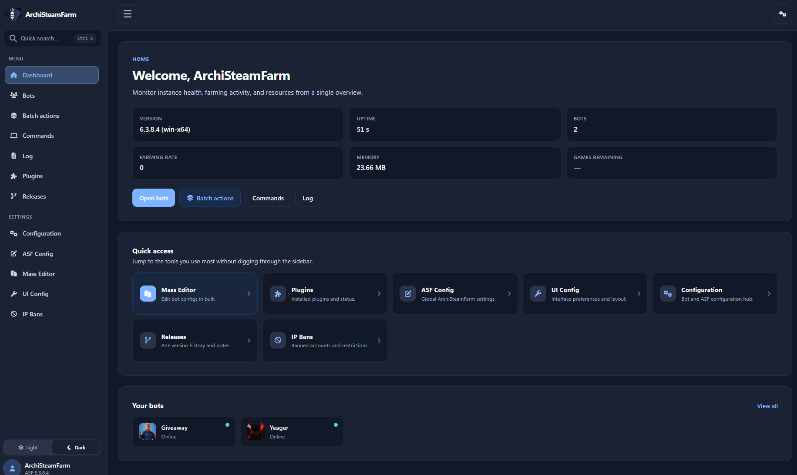
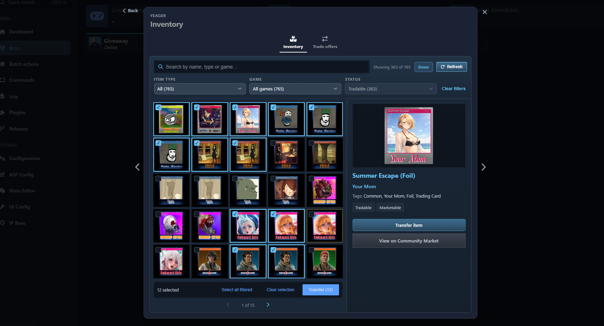
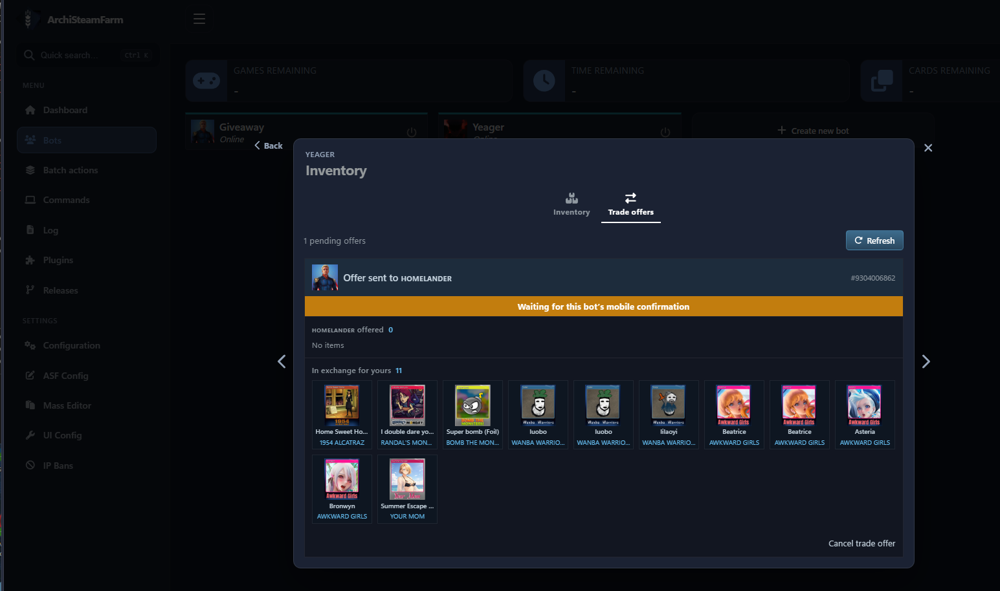
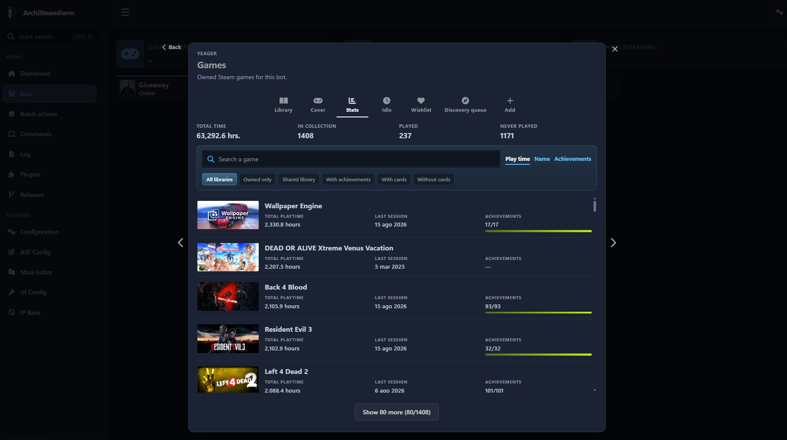
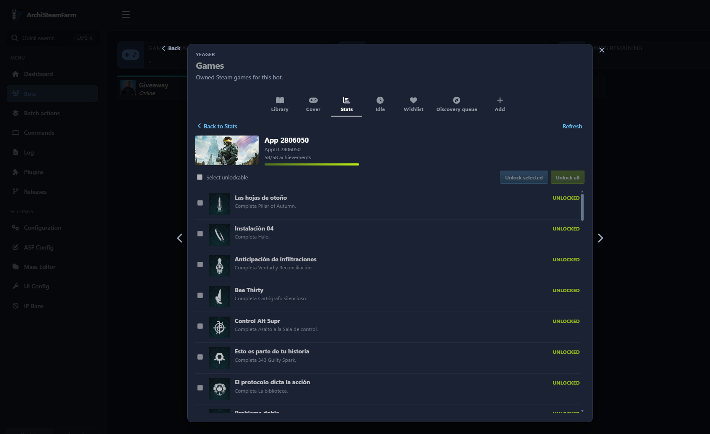
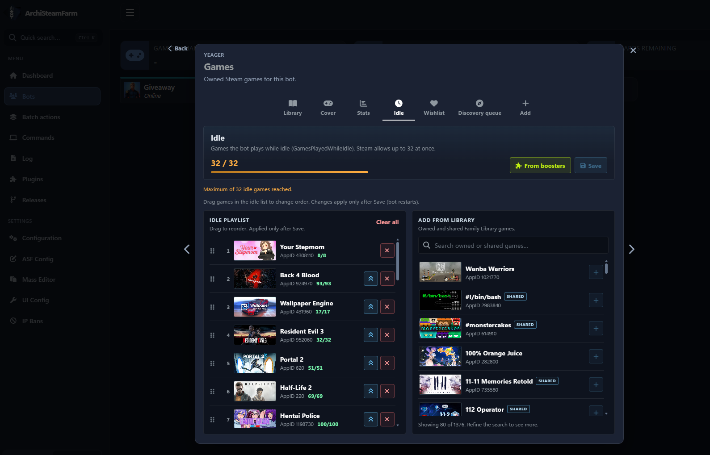
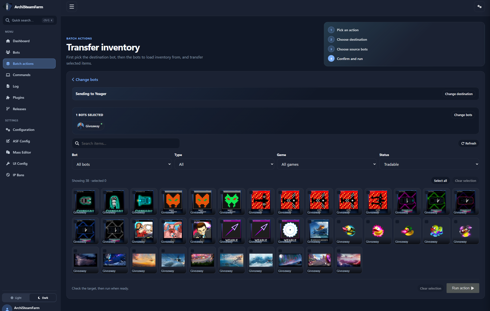

<p align="center">
  
</p>

<h1 align="center">asf-bot-social</h1>

<p align="center">
  Paquete combinado de Bot Social para <strong>ArchiSteamFarm</strong>: interfaz web + plugin <code>ASFBotSocial</code>.<br/>
  No es un fork del núcleo de ASF. No es la ASF-ui oficial.
</p>

<p align="center">
  <a href="README.md">English</a> · <strong>Español</strong>
</p>

<p align="center">
  <a href="https://github.com/cybercodelabs/asf-bot-social">
    
  </a>
  <a href="https://github.com/JustArchiNET/ArchiSteamFarm">
    
  </a>
  
  
  
  <a href="https://github.com/Jeremias0618/ASF-ui/releases">
    
  </a>
  <a href="https://github.com/Jeremias0618/ASF-Plugin/releases">
    
  </a>
</p>

<p align="center">
  <a href="https://hits.sh/github.com/cybercodelabs/asf-bot-social/">
    
  </a>
</p>

---

> [!IMPORTANT]
> Esto **no** es [JustArchiNET/ArchiSteamFarm](https://github.com/JustArchiNET/ArchiSteamFarm) ni la [ASF-ui oficial](https://github.com/JustArchiNET/ASF-ui). Sigues usando el binario **oficial** de ASF. Este repo solo aporta una UI en `www/` y un DLL de plugin. Licencia Apache-2.0.

> [!IMPORTANT]
> Bot Social necesita **las dos** piezas. La UI sin el plugin no tiene IPC. El plugin sin esta UI no tiene pantallas.

## Qué es este repo

Monorepo que junta los dos proyectos de Bot Social:

| Carpeta | Rol | Origen |
|---------|-----|--------|
| [`ASF-ui/`](ASF-ui/) | Interfaz web (amigos, comunidad, juegos, wishlist, transferencia de inventario, inactividad, acciones por lote) | [Jeremias0618/ASF-ui](https://github.com/Jeremias0618/ASF-ui) (fork de [JustArchiNET/ASF-ui](https://github.com/JustArchiNET/ASF-ui)) |
| [`ASF-Plugin/`](ASF-Plugin/) | Plugin IPC `ASFBotSocial` | [Jeremias0618/ASF-Plugin](https://github.com/Jeremias0618/ASF-Plugin) |

Mantenedor: [Jeremias0618](https://github.com/Jeremias0618) / [CyberCode Labs](https://github.com/cybercodelabs).

## Vista previa

<table>
  <tr>
    <td align="center"><br/>Dashboard</td>
    <td align="center"><br/>Inventario</td>
  </tr>
  <tr>
    <td align="center"><br/>Ofertas de intercambio</td>
    <td align="center"><br/>Juegos — stats</td>
  </tr>
  <tr>
    <td align="center"><br/>Logros</td>
    <td align="center"><br/>Inactividad</td>
  </tr>
  <tr>
    <td align="center" colspan="2"><br/>Acciones por lote — transferir inventario</td>
  </tr>
</table>

## Instalación (releases compilados)

Los usuarios **no** necesitan Node.js ni .NET. Detén ArchiSteamFarm primero. Sustituye `RUTA_DE_TU_ARCHISTEAMFARM` por la carpeta que contiene `ArchiSteamFarm.exe`.

> [!NOTE]
> En PowerShell de Windows **no** uses `curl` ni `unzip` (son de Linux; `curl` ahí es un alias de `Invoke-WebRequest`). Copia el bloque **Windows**.

> [!WARNING]
> Una actualización oficial de ASF puede pisar `www/`. Tras actualizar ASF, vuelve a extraer la UI (o desactiva el auto-update de la UI si mantienes un `www/` personalizado). El DLL del plugin debe coincidir con la versión **exacta** de `ArchiSteamFarm.exe`.

**Windows (PowerShell)**

```powershell
cd "RUTA_DE_TU_ARCHISTEAMFARM"

curl.exe -L -o ASF-ui.zip "https://github.com/Jeremias0618/ASF-ui/releases/latest/download/ASF-ui.zip"
Expand-Archive -Path "ASF-ui.zip" -DestinationPath "www" -Force
Remove-Item "ASF-ui.zip"

curl.exe -L -o ASFBotSocial.zip "https://github.com/Jeremias0618/ASF-Plugin/releases/latest/download/ASFBotSocial.zip"
New-Item -ItemType Directory -Force -Path "plugins\ASFBotSocial" | Out-Null
Expand-Archive -Path "ASFBotSocial.zip" -DestinationPath "plugins\ASFBotSocial" -Force
Remove-Item "ASFBotSocial.zip"
```

**Linux / macOS**

```bash
cd "RUTA_DE_TU_ARCHISTEAMFARM"

curl -L -o ASF-ui.zip "https://github.com/Jeremias0618/ASF-ui/releases/latest/download/ASF-ui.zip"
unzip -o ASF-ui.zip -d www
rm ASF-ui.zip

curl -L -o ASFBotSocial.zip "https://github.com/Jeremias0618/ASF-Plugin/releases/latest/download/ASFBotSocial.zip"
mkdir -p plugins/ASFBotSocial
unzip -o ASFBotSocial.zip -d plugins/ASFBotSocial
rm ASFBotSocial.zip
```

Arranca ASF y abre `http://localhost:1242` (recarga forzada una vez). Debes tener:

- `www/` — esta UI
- `plugins/ASFBotSocial/ASFBotSocial.dll` — el plugin

Guías por componente: [ASF-ui/README-ESP.md](ASF-ui/README-ESP.md) · [ASF-Plugin/README-ESP.md](ASF-Plugin/README-ESP.md)

## Estructura

```text
asf-bot-social/
├── ASF-ui/          # UI Vue 2.7 → extraer el build en www/ de ASF
├── ASF-Plugin/      # plugin C# ASFBotSocial → plugins/ASFBotSocial/
├── README.md
├── README-ESP.md
└── LICENSE          # Apache-2.0
```

## Desarrollo

- **UI:** `cd ASF-ui` → `pnpm install` → `pnpm run deploy` (sale en `dist/`; copiar a `www/` de ASF).
- **Plugin:** clona [ArchiSteamFarm](https://github.com/JustArchiNET/ArchiSteamFarm) en el tag correspondiente junto a este repo (o en `ASF-Plugin/ArchiSteamFarm`) y luego `dotnet build ASF-Plugin/ASFBotSocial/ASFBotSocial.csproj -c Release`.

## Relacionado

| Pieza | Repo |
|-------|------|
| Este monorepo | https://github.com/cybercodelabs/asf-bot-social |
| UI (código / releases) | https://github.com/Jeremias0618/ASF-ui |
| Plugin (código / releases) | https://github.com/Jeremias0618/ASF-Plugin |
| Núcleo ASF | https://github.com/JustArchiNET/ArchiSteamFarm |
| UI upstream | https://github.com/JustArchiNET/ASF-ui |

## Licencia y créditos

- ArchiSteamFarm y ASF-ui upstream: [JustArchiNET](https://github.com/JustArchiNET) — Apache-2.0
- Este fork de UI, `ASFBotSocial` y este monorepo: [Jeremias0618](https://github.com/Jeremias0618) / [CyberCode Labs](https://github.com/cybercodelabs)

> [!WARNING]
> Solicitudes masivas de amistad o spam de wishlist pueden violar las reglas de Steam. Prefiere acciones por lote con ritmo desde la UI.
