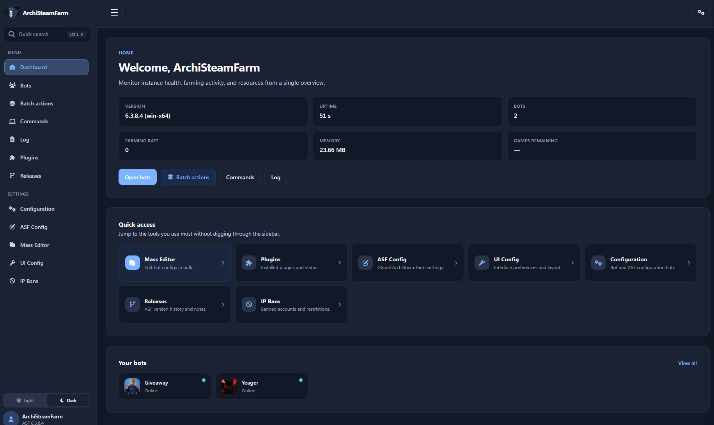
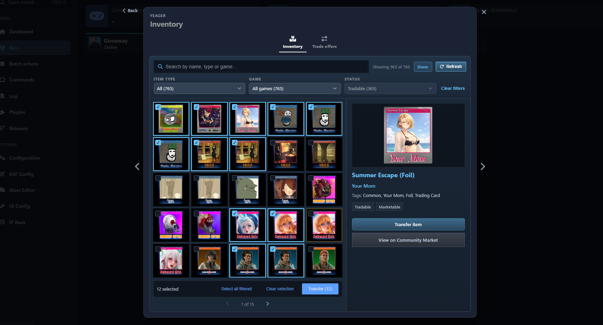
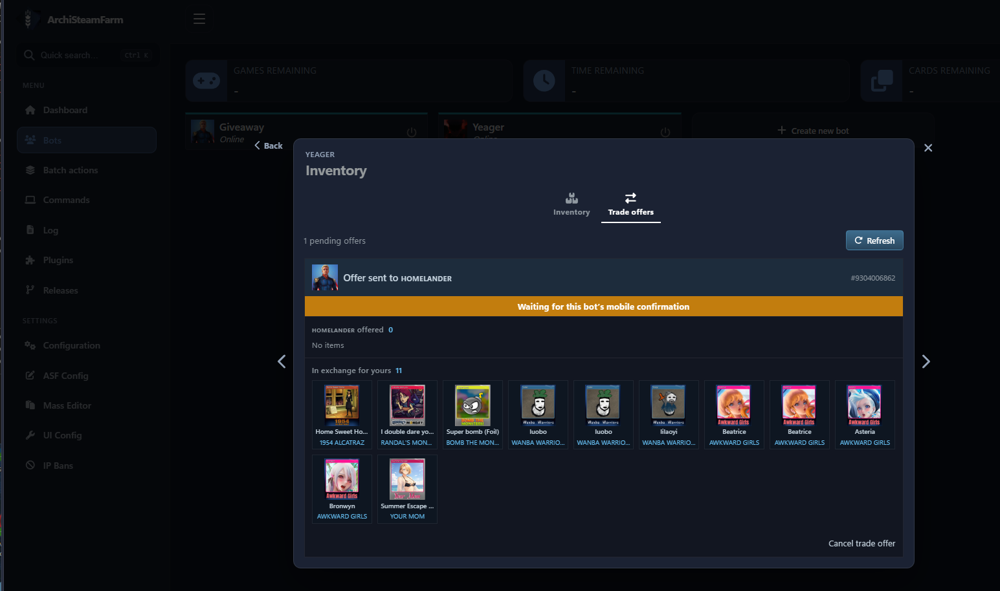
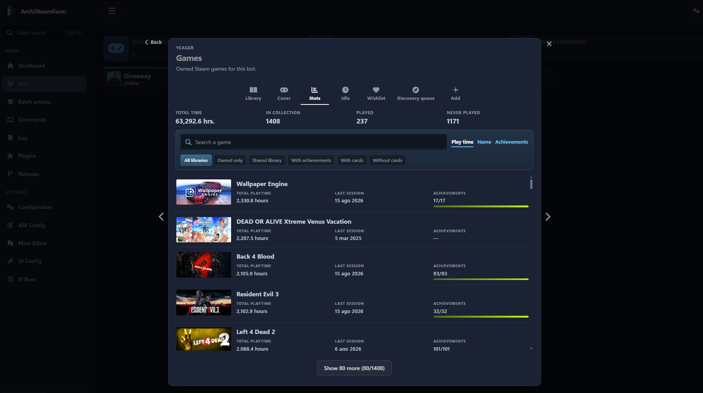
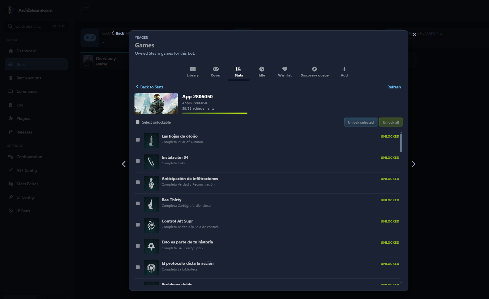
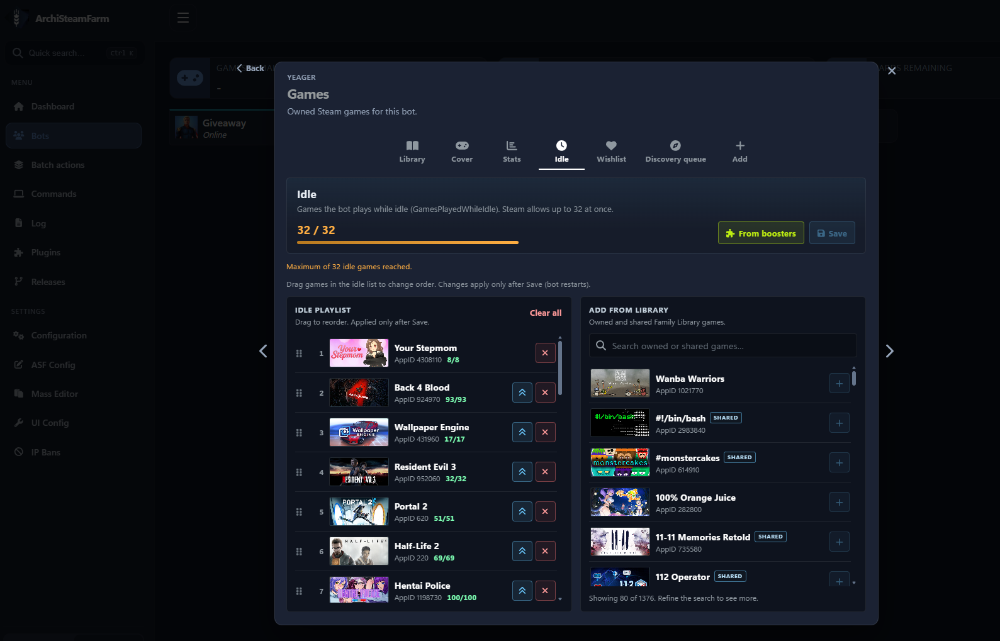
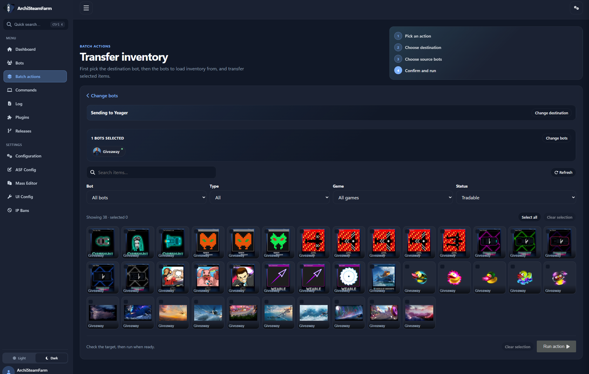

<p align="center">
  
</p>

<h1 align="center">asf-bot-social</h1>

<p align="center">
  Combined <strong>ArchiSteamFarm</strong> Bot Social package: custom web UI + <code>ASFBotSocial</code> plugin.<br/>
  Not a fork of the ASF core. Not the official ASF-ui.
</p>

<p align="center">
  <strong>English</strong> · <a href="README-ESP.md">Español</a>
</p>

<p align="center">
  <a href="https://github.com/cybercodelabs/asf-bot-social">
    
  </a>
  <a href="https://github.com/JustArchiNET/ArchiSteamFarm">
    
  </a>
  
  
  
  <a href="https://github.com/Jeremias0618/ASF-ui/releases">
    
  </a>
  <a href="https://github.com/Jeremias0618/ASF-Plugin/releases">
    
  </a>
</p>

<p align="center">
  <a href="https://hits.sh/github.com/cybercodelabs/asf-bot-social/">
    
  </a>
</p>

---

> [!IMPORTANT]
> This is **not** [JustArchiNET/ArchiSteamFarm](https://github.com/JustArchiNET/ArchiSteamFarm) and **not** the official [JustArchiNET/ASF-ui](https://github.com/JustArchiNET/ASF-ui). You still run the **official** ASF binary. This repo only ships a custom `www/` UI and a plugin DLL. License is Apache-2.0.

> [!IMPORTANT]
> Bot Social needs **both** pieces. The UI without the plugin has no IPC. The plugin without this UI has no screens.

## What this repo is

Monorepo that gathers the two projects that make Bot Social work:

| Folder | Role | Source |
|--------|------|--------|
| [`ASF-ui/`](ASF-ui/) | Custom web UI (friends, community, games, wishlist, inventory transfer, idle, batch actions) | [Jeremias0618/ASF-ui](https://github.com/Jeremias0618/ASF-ui) (fork of [JustArchiNET/ASF-ui](https://github.com/JustArchiNET/ASF-ui)) |
| [`ASF-Plugin/`](ASF-Plugin/) | `ASFBotSocial` IPC plugin | [Jeremias0618/ASF-Plugin](https://github.com/Jeremias0618/ASF-Plugin) |

Maintainer: [Jeremias0618](https://github.com/Jeremias0618) / [CyberCode Labs](https://github.com/cybercodelabs).

## Preview

<table>
  <tr>
    <td align="center"><br/>Dashboard</td>
    <td align="center"><br/>Inventory</td>
  </tr>
  <tr>
    <td align="center"><br/>Trade offers</td>
    <td align="center"><br/>Games — stats</td>
  </tr>
  <tr>
    <td align="center"><br/>Achievements</td>
    <td align="center"><br/>Idle</td>
  </tr>
  <tr>
    <td align="center" colspan="2"><br/>Batch actions — transfer inventory</td>
  </tr>
</table>

## Install (compiled releases)

End users do **not** need Node.js or .NET. Stop ArchiSteamFarm first. Replace `PATH_TO_YOUR_ARCHISTEAMFARM` with the folder that contains `ArchiSteamFarm.exe`.

> [!NOTE]
> On Windows PowerShell do **not** use `curl` or `unzip` (those are Linux commands; `curl` there is an alias for `Invoke-WebRequest`). Copy the **Windows** block.

> [!WARNING]
> Official ASF updates can overwrite `www/`. After an ASF update, extract the UI again (or disable UI auto-update if you keep a custom `www/`). The plugin DLL must match the **exact** `ArchiSteamFarm.exe` version.

**Windows (PowerShell)**

```powershell
cd "PATH_TO_YOUR_ARCHISTEAMFARM"

curl.exe -L -o ASF-ui.zip "https://github.com/Jeremias0618/ASF-ui/releases/latest/download/ASF-ui.zip"
Expand-Archive -Path "ASF-ui.zip" -DestinationPath "www" -Force
Remove-Item "ASF-ui.zip"

curl.exe -L -o ASFBotSocial.zip "https://github.com/Jeremias0618/ASF-Plugin/releases/latest/download/ASFBotSocial.zip"
New-Item -ItemType Directory -Force -Path "plugins\ASFBotSocial" | Out-Null
Expand-Archive -Path "ASFBotSocial.zip" -DestinationPath "plugins\ASFBotSocial" -Force
Remove-Item "ASFBotSocial.zip"
```

**Linux / macOS**

```bash
cd "PATH_TO_YOUR_ARCHISTEAMFARM"

curl -L -o ASF-ui.zip "https://github.com/Jeremias0618/ASF-ui/releases/latest/download/ASF-ui.zip"
unzip -o ASF-ui.zip -d www
rm ASF-ui.zip

curl -L -o ASFBotSocial.zip "https://github.com/Jeremias0618/ASF-Plugin/releases/latest/download/ASFBotSocial.zip"
mkdir -p plugins/ASFBotSocial
unzip -o ASFBotSocial.zip -d plugins/ASFBotSocial
rm ASFBotSocial.zip
```

Start ASF and open `http://localhost:1242` (hard-reload once). You should have:

- `www/` — this UI
- `plugins/ASFBotSocial/ASFBotSocial.dll` — the plugin

Guides per component: [ASF-ui/README.md](ASF-ui/README.md) · [ASF-Plugin/README.md](ASF-Plugin/README.md)

## Layout

```text
asf-bot-social/
├── ASF-ui/          # Vue 2.7 web UI → extract build into ASF www/
├── ASF-Plugin/      # ASFBotSocial C# plugin → plugins/ASFBotSocial/
├── README.md
├── README-ESP.md
└── LICENSE          # Apache-2.0
```

## Development

- **UI:** `cd ASF-ui` → `pnpm install` → `pnpm run deploy` (output in `dist/`, copy to ASF `www/`).
- **Plugin:** clone [ArchiSteamFarm](https://github.com/JustArchiNET/ArchiSteamFarm) at the matching tag next to this repo (or as `ASF-Plugin/ArchiSteamFarm`), then `dotnet build ASF-Plugin/ASFBotSocial/ASFBotSocial.csproj -c Release`.

## Related

| Piece | Repo |
|-------|------|
| This monorepo | https://github.com/cybercodelabs/asf-bot-social |
| UI (source / releases) | https://github.com/Jeremias0618/ASF-ui |
| Plugin (source / releases) | https://github.com/Jeremias0618/ASF-Plugin |
| ASF core | https://github.com/JustArchiNET/ArchiSteamFarm |
| Upstream UI | https://github.com/JustArchiNET/ASF-ui |

## License and credits

- ArchiSteamFarm and upstream ASF-ui: [JustArchiNET](https://github.com/JustArchiNET) — Apache-2.0
- This UI fork, `ASFBotSocial`, and this monorepo: [Jeremias0618](https://github.com/Jeremias0618) / [CyberCode Labs](https://github.com/cybercodelabs)

> [!WARNING]
> Mass friend requests or wishlist spam can violate Steam rules. Prefer paced multi-actions from the UI.
